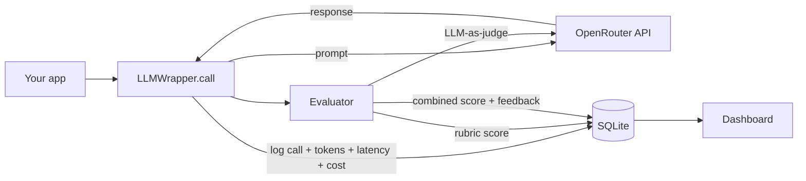

<div align="center">

# LLM Observability & Evaluation Harness

**Trace, evaluate, and monitor your LLM calls - latency, cost, token usage, and output quality - in one lightweight dashboard.**


</div>

A zero-dependency-thought, batteries-included service that wraps any OpenRouter model, logs every prompt/response, measures latency and cost, scores answer quality with both rule-based rubrics and an LLM-as-judge, and visualizes everything on a live dashboard.

---

## Highlights

| | |
|---|---|
| ⚡ **Transparent wrapper** | All LLM traffic flows through a thin `LLMWrapper`, so observability is automatic. |
| 📊 **Live dashboard** | Flask + Plotly dashboard shows KPIs, latency/cost/eval trends, and a searchable call table. |
| 🧭 **Dual evaluation** | Rule-based rubric scoring plus LLM-as-judge, or a combined average. |
| 💰 **Cost tracking** | Per-call cost computed from token usage; free (`:free`) models are charged $0. |
| 🗄️ **Zero-config storage** | SQLite - no server, no migration tooling, just a file. |

---

## How it works



1. `LLMWrapper.call(...)` sends the prompt to OpenRouter and times the request.
2. The call - model, prompt, response, latency, cost, tokens - is written to SQLite.
3. `Evaluator` scores the answer with a weighted rubric and/or an LLM-as-judge.
4. The score is attached to the **correct** call and both feed the dashboard.

---

## Quick start

```bash
# 1. Create a virtual environment and install dependencies
python3 -m venv venv && source venv/bin/activate

# 2. Install requirements
pip install -r requirements.txt

# 3. Set your OpenRouter key (also reads .env via python-dotenv)
export OPENROUTER_API_KEY='your-api-key-here'

# 4. Run a smoke test with three example prompts
python main.py

# 5. Start the dashboard
python dashboard.py
# -> http://localhost:5001   (override with DASHBOARD_PORT)
```

`setup.sh` automates steps 1-2.

---

## Configuration

| Variable | Default | Description |
| --- | --- | --- |
| `OPENROUTER_API_KEY` | - | Required. API key used by the OpenAI-compatible client. |
| `DASHBOARD_PORT` | `5001` | HTTP port for the dashboard. Avoid `5000` on macOS (AirPlay Receiver claims it). |

---

## Example monitoring output

The dashboard aggregates every logged call. Here is representative output from a 180-call stress run across five models (an example dataset generated with the same schema your `main.py` run produces):

```json
{
  "total_calls": 180,
  "avg_latency": 1.974,
  "total_cost": 0.361394,
  "avg_eval_score": 0.74
}
```

**Metric breakdown from that run:**

| Metric | Value | Notes |
| --- | --- | --- |
| total_calls | 180 | One logged call per prompt (judge calls are excluded). |
| avg_latency | 1.974 s | Mean end-to-end request time. |
| total_cost | $0.361394 | Sum of per-call token cost. |
| avg_eval_score | 0.74 / 1.0 | Mean of combined rubric + LLM-judge scores. |

The dashboard also plots latency, cumulative cost, and evaluation score over time, plus a recent-calls table with model, prompt preview, latency, cost, and eval score per call.

---

## Evaluation methodology

Every response is scored 0.0-1.0. Two independent signals are available:

### 1. Rule-based rubric (no network)

| Criterion | Weight | Pass rule |
| --- | --- | --- |
| `length` | 0.30 | 50-1000 chars |
| `relevance` | 0.30 | keyword match (extensible) |
| `has_numbers` | 0.20 | contains a numeric digit |
| `has_structure` | 0.20 | paragraphs or list markers |

Final score = `Σ (criterion_score × weight)`.

### 2. LLM-as-judge (network)

A judge model rates the response on a 1-10 scale and returns structured feedback. The score is normalized to 0-1 (`score / 10`).

### 3. Combined

`evaluate(prompt, response, method='both')` averages rubric and judge scores and returns the detailed breakdown plus judge feedback.

---

## Cost model

```python
cost = 0 if 'free' in model.lower() else tokens_used * 0.00001
```

- `:free` OpenRouter models are always charged `$0.00`.
- Paid models are billed at a flat `$0.01 / 1K tokens`, giving a reproducible upper bound.

---

## Database schema

SQLite file `llm_observability.db` (auto-created; add to `.gitignore`).

| Column | Type | Description |
| --- | --- | --- |
| `id` | INTEGER PK | Auto-incrementing call id. |
| `timestamp` | TEXT | ISO-8601 time of the call. |
| `model` | TEXT | OpenRouter model id. |
| `prompt` | TEXT | Full submitted prompt. |
| `response` | TEXT | Full model response. |
| `latency` | REAL | Request time in seconds. |
| `cost` | REAL | Estimated cost in USD. |
| `tokens_used` | INTEGER | Total tokens reported by the API. |
| `eval_score` | REAL | Combined evaluation score (0-1), nullable. |
| `eval_feedback` | TEXT | Judge/rubric feedback, nullable. |

---

## Library usage

```python
from llm_wrapper import LLMWrapper
from evaluator import Evaluator

wrapper = LLMWrapper(model='openai/gpt-4o-mini')
result = wrapper.call("What is the capital of France?")   # -> id, content, latency, cost, tokens_used

evaluator = Evaluator()

rubric = evaluator.evaluate_with_rubric(prompt, response)
judge  = evaluator.evaluate_with_llm_judge(prompt, response)
both   = evaluator.evaluate(prompt, response, method='both')
```

**Internal calls stay out of your metrics.** The LLM-as-judge runs with `log=False`, so judge requests never inflate `total_calls` or skew latency/cost. Only your real calls are traced.

---

## Project structure

```
llm_observability/
├── main.py          # Smoke-test runner: calls a model, evaluates, prints metrics
├── llm_wrapper.py   # OpenRouter wrapper + cost + persistence
├── evaluator.py     # Rubric + LLM-as-judge scoring
├── database.py      # SQLite layer (safe context-managed connections)
├── dashboard.py     # Flask + Plotly dashboard
├── templates/
│   └── dashboard.html
├── requirements.txt
├── setup.sh         # Venv + dependency bootstrap
└── .env.example
```

---

## Extending it

- **More rubric criteria** - add a key to the default rubric dict and a matching score in `evaluate_with_rubric`.
- **Real per-model pricing** - replace `_calculate_cost` with a token-based price table keyed by model.
- **Auth for the dashboard** - add a login decorator in `dashboard.py`.
- **A real request log** - `LLMWrapper.call(..., log=False)` exists if you want fire-and-forget calls without persistence.

---

## License

[MIT](LICENSE)